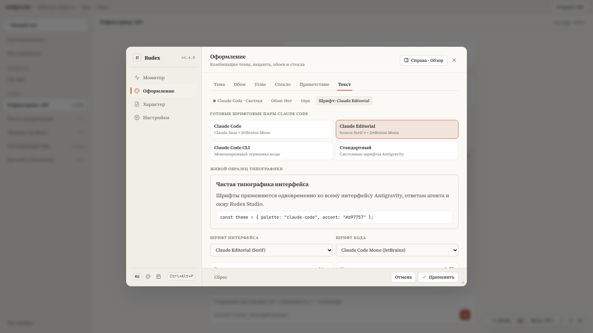
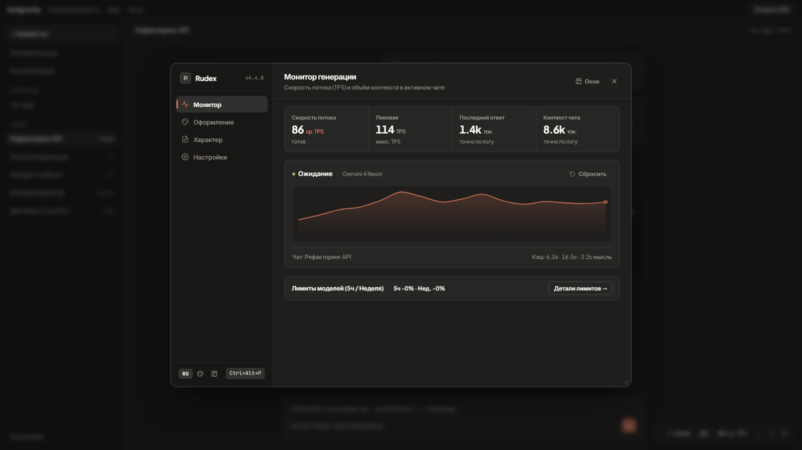

<div align="center">
  
  <h1>Rudex</h1>
  <p><strong>Студия кастомизации, стили Claude Code / Codex / OpenCode, живые лимиты, правки на лету и русификация Google Antigravity 2.0</strong></p>

  <p>
    
    
    
    
    
  </p>
</div>

---

## Быстрая установка и обновление в 1 команду (Windows PowerShell)

Откройте **Windows PowerShell** и выполните:

```powershell
irm https://raw.githubusercontent.com/Ivan0967pro/Rudex/main/install.ps1 | iex
```

Скрипт сам скачает свежую версию **Rudex**, установит или обновит плагин в `%USERPROFILE%\.gemini\config\plugins\rudex`, пропатчит интерфейс и перезапустит Antigravity. Все ваши настройки, темы, обои, характеры чатов, статистика TPS и квоты сохраняются в `%APPDATA%\Antigravity\`.

---

## Что умеет Rudex

| | Функция | Что даёт |
| :-- | :--- | :--- |
| 🎛️ | **4 стиля UI платформ** | Готовые структурные стили для поля ввода, чатов и меню моделей: **Antigravity**, **Claude Code** (раздельная строка `Reply ... ↵` + нижняя панель снаружи), **OpenAI Codex** и **OpenCode** + Mix & Match по зонам и тонкие настройки. |
| 🎨 | **Темы, шрифты, обои и «Прицел»** | 14+ тем (включая тёмную/светлую **Claude Code**, **Светлая бумага**, **Скандинавский лёд**, **Жидкое стекло**), 4 раздельных слота шрифтов (**ChatGPT Sans, OpenCode Mono, Claude Sans/Serif, Golos, Onest** + системные шрифты Windows), обои/видео и «Прицел» (`Ctrl+Alt+E`) для настройки и переименования любых элементов. |
| 📊 | **Динамические лимиты и TPS** | Закреплённый или плавающий мини-виджет и экранное окно **«Лимиты Antigravity»**: живые квоты `5ч / Неделя`, автообновление по шагам без ручного захода в View Usage, тикающий таймер сброса и просмотр лимитов по клику на модель даже во время работы агента. |
| ⚡ | **Правки на лету и карандаш** | Отправка дополнений, скриншотов и файлов агенту прямо во время работы (без остановки генерации) + встроенный редактор-аннотатор скриншотов карандашом и стрелками. |
| 💾 | **Черновики чатов и история ввода** | Автосохранение набранного текста и прикреплённых файлов отдельно для каждого чата и нового чата + история последних 20 сообщений с быстрым копированием текста и файлов. |
| 🧩 | **Пульт агента и Мастерская AGY** | Быстрый выбор режимов (`Авто / Вкл / Выкл`), пресеты возможностей, характер чата, визуальное управление Rules / Skills / MCP / Hooks, редактор горячих клавиш, экспорт в ZIP и автообновления. |
| 🇷🇺 | **Полная русификация и перевод мыслей** | Всё приложение на русском с мгновенным переключением `RU ↔ EN` (`Ctrl+Alt+L`) + автоматический бесплатный перевод мыслей агента без расхода токенов и лимитов моделей. |

Все настройки открываются в окне **Rudex Studio** — `Ctrl+Alt+P`, клик по виджету или пункт **Rudex** в основных настройках Antigravity.

---

## Скриншоты

### Русский интерфейс, мысли агента и виджет скорости


### Окно Rudex Studio
<table>
  <tr>
    <td width="50%" align="center">
      <strong>Оформление и палитры Claude Code (Тёмная)</strong><br /><br />
      
    </td>
    <td width="50%" align="center">
      <strong>Шрифты Claude Code и светлая тема (Пергамент)</strong><br /><br />
      
    </td>
  </tr>
  <tr>
    <td width="50%" align="center">
      <strong>Монитор скорости (TPS) и контекста</strong><br /><br />
      
    </td>
    <td width="50%" align="center">
      <strong>Характер чата и шаблоны</strong><br /><br />
      
    </td>
  </tr>
  <tr>
    <td colspan="2" align="center">
      <strong>Экспорт диалога в ZIP и лимиты моделей</strong><br /><br />
      
    </td>
  </tr>
</table>

---

## Горячие клавиши

| Сочетание | Действие |
| :--- | :--- |
| `Ctrl + Alt + P` | Открыть / закрыть окно **Rudex Studio** |
| `Ctrl + Alt + L` | Мгновенное переключение языка интерфейса (`RU` ↔ `EN`) |
| `Ctrl + / − / 0` | Увеличить, уменьшить или сбросить масштаб Antigravity |
| `Зажать виджет (закреплён)` | Плавно изменить масштаб мини-окна / карточки |
| `Клик по виджету` | Открыть / развернуть **Rudex Studio** |

---

## Локальная установка и удаление

Если репозиторий уже клонирован (`git clone https://github.com/Ivan0967pro/Rudex.git`):

- **Установка / обновление:** запустите **[`Install-Rudex.cmd`](./Install-Rudex.cmd)** или `powershell -ExecutionPolicy Bypass -File .\install.ps1 -RestartApp`.
- **Полное удаление:** удалите плагин **Rudex** в интерфейсе Antigravity и перезапустите приложение, либо запустите **[`Uninstall-Rudex.cmd`](./Uninstall-Rudex.cmd)** / `powershell -ExecutionPolicy Bypass -File .\install.ps1 -Uninstall -RestartApp`.

---

## Что нового в v5.0.0

- **4 стиля интерфейса платформ (`Оформление → Стиль UI`)** — переключение в 1 клик между **Antigravity**, **Claude Code** (отдельная однострочная коробка `Reply ... ↵` и панель `+ / 🎤 / Модель / Режим` снаружи под ней), **OpenAI Codex** (объёмная `22px` капсула с разделённым футером и монохромной кнопкой отправки) и **OpenCode** (терминальный `6px` фрейм с `❯`, левой акцент-полосой и моно-бейджем моделей) + **Mix & Match** по зонам и полная детальная настройка.
- **Динамическое автообновление лимитов Antigravity** — окно **«Лимиты Antigravity»** и карточка `M` обновляют остаток `5ч / Неделя` автоматически в фоне по реальным шагам чата, таймеры сброса тикают в реальном времени и сами сбрасывают истёкшее 5-часовое окно, а на кнопку выбора модели можно кликнуть даже во время работы агента, чтобы сразу посмотреть текущие лимиты.
- **Закреплённые виджеты как часть интерфейса + синхронизация тем и кнопок окна** — мини-окно и окно лимитов по умолчанию встроены в интерфейс (с переключением в плавающий режим и выбором любого угла/шапки, шрифта и размера), кнопки закрытия/сворачивания окна Windows автоматически подстраиваются под активную тему, а светлые темы (`Claude Code · Светлая`, `Светлая бумага`, `Скандинавский лёд`) полностью доведены до идеальной читаемости.
- **Автосохранение черновиков и история последних 20 сообщений** — набранный текст и прикреплённые скриншоты/файлы сохраняются отдельно в каждом чате и в новом чате даже после перезапуска, а в настройках доступна история последних 20 отправленных сообщений с копированием текста и файлов в буфер обмена.
- **Бесплатный перевод мыслей агента (0 расхода лимитов)** — по умолчанию мысли агента переводятся автоматически на русский через бесплатный переводчик без инъекции лишних промптов и без сжигания квот.
- **Правки агенту на лету с файлами и аннотатором скриншотов** — печатай дополнения с прикреплёнными скриншотами и файлами прямо во время работы агента, рисуй пометки карандашом и стрелками прямо на прикреплённом скриншоте и управляй отображением статуса «Учтено агентом».
- **Визуальный «Прицел» (`Ctrl+Alt+E`) с реальными значениями + популярные шрифты** — инспектор элементов показывает реальные вычисленные размеры/скругления с ползунками и сбросом, добавлены шрифты **ChatGPT (OpenAI Sans)**, **OpenCode (JetBrains Mono)**, **Golos Text**, **Onest**, **Manrope**, **Plus Jakarta Sans**, **Nunito**, **Source Code Pro**, **Space Mono**, **Ubuntu Mono** и поддержка всех системных шрифтов Windows.
- **«Пульт агента», «Мастерская AGY» и Редактор горячих клавиш** — аккуратный чип инструментов (`Авто` по умолчанию), пресеты возможностей, визуальное управление Rules / Skills / MCP / Hooks, 16 настраиваемых хоткеев, поиск по настройкам, JSON-бекап профиля и интеграция пункта **Rudex** в родные `⚙ Настройки` Antigravity.

## Что нового в v4.4.0

- **Полный редизайн Rudex Studio и виджета** — чистая редакционная эстетика без лишнего шума, глянцевых градиентов и вложенных рамок: геометрическая монограмма, underline-вкладки, единая панель телеметрии с hairline-разделителями, мини-превью палитр и спокойный спарклайн.
- **Цвета Claude Code / Anthropic** — новые темы **Claude Code · Тёмная** (`#1F1E1D` / `#262624` / `#D97757`), **Claude Code · Светлая** (`#FAF9F5` / `#F0EEE6` / `#C15F3C`) и **Claude Code · Терминал** (`#141413`), отдельные темы окна Studio и виджета + быстрое переключение в 1 клик.
- **Шрифты Claude Code** — добавлены **Claude Sans**, **Claude Editorial (Source Serif 4)**, **Claude Reading (Lora)**, **Claude Code CLI**, **Geist**, **Claude Code Mono (JetBrains Mono)** и **Geist Mono** с автоматической подгрузкой веб-шрифтов и синхронизацией между всем интерфейсом Antigravity и меню Rudex Studio.
- **Отдельный масштаб интерфейса, окна Studio и виджета** — независимое масштабирование Antigravity (`70–150%`), окна Rudex Studio (включая плавный resize за уголок) и закреплённого виджета (удержанием мышкой).
