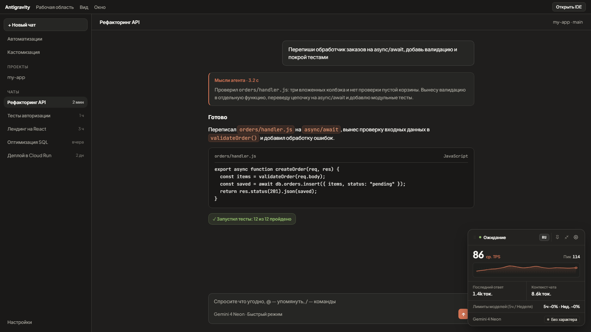
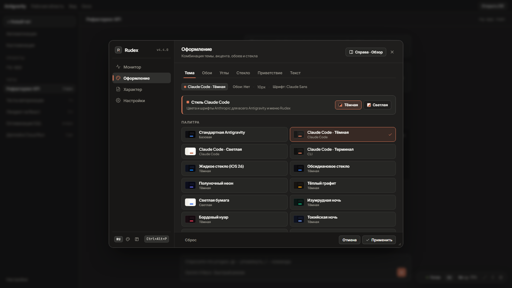
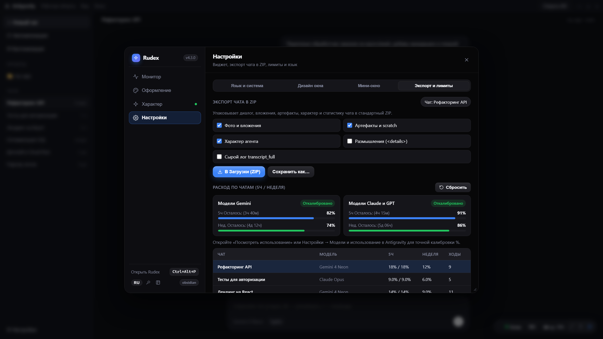

<div align="center">
  
  <h1>Rudex 5.0</h1>
  <p><strong>Студия кастомизации, стили Claude Code / Codex / OpenCode, живые лимиты, контекст модели, правки на лету и полная русификация Google Antigravity 2.0</strong></p>

  <p>
    
    
    
    
    
  </p>
</div>

---

## Установка и обновление в 1 команду (Windows PowerShell)

```powershell
irm https://raw.githubusercontent.com/Ivan0967pro/Rudex/main/install.ps1 | iex
```

Скрипт скачает свежую версию **Rudex 5.0.0**, установит или обновит плагин в `%USERPROFILE%\.gemini\config\plugins\rudex`, аккуратно пропатчит интерфейс и перезапустит Antigravity.

> **Уже стоит Rudex 4.x?** Обновление до **v5.0.0** прилетит автоматически прямо внутри Antigravity (кнопка **«Обновить сейчас»** в уведомлении или **Система → Проверить обновления**). Все настройки, темы, обои, характеры чатов, статистика TPS и квоты сохраняются в `%APPDATA%\Antigravity\`.

---

## Возможности Rudex 5.0

| | Модуль | Что даёт |
| :-- | :--- | :--- |
| 🎛️ | **4 стиля интерфейса платформ** | Мгновенное переключение между **Antigravity**, **Claude Code** (ровный однострочный и многострочный композер, стабильная диктовка и микрофон, чистая панель под полем ввода), **OpenAI Codex** и **OpenCode** + **Mix & Match** по зонам и полные комплекты платформы в 1 клик. |
| 🎨 | **Темы, шрифты, обои и «Прицел»** | 14+ тем (включая **Claude Code · Тёмная / Светлая / Терминал**, **Светлая бумага**, **Скандинавский лёд**, **Жидкое стекло**), 4 раздельных слота шрифтов (+ системные шрифты Windows), студия обоев (фото, видео, градиенты, пресеты атмосферы, кадрирование, зум `Ctrl + колесо`), конструктор скруглений и «Прицел» (`Ctrl+Alt+E`) для правки и переименования любых элементов. |
| 📊 | **Живые лимиты, уведомления и контекст модели** | Встроенные или плавающие виджеты (`5ч / Неделя`, автообновление, таймер сброса, клик по модели во время работы агента), **кликабельные уведомления на рабочий стол** о завершении задачи и восстановлении лимитов (приходят **даже при закрытом Antigravity**), опциональный **индикатор контекстного окна модели** в чате (выкл. по умолчанию) и **автопродолжение чата** после восстановления лимитов (выкл. по умолчанию). |
| 🧭 | **Обновлённая Rudex Studio (6 разделов)** | Простая навигация: **Монитор · Виджеты · Оформление · Инструменты · Пульт агента · Система**. Липкие подвкладки, неблокирующая боковая панель с живым предпросмотром и историей `Назад / Вперёд`, быстрый поиск по настройкам и вход в **Rudex** прямо из родных `⚙ Настройки` Antigravity. |
| ⚡ | **Правки на лету с карандашом** | Отправка дополнений, скриншотов и файлов агенту без остановки текущего ответа + встроенный аннотатор скриншотов (карандаш, стрелки, рамки, текст) и настраиваемая метка «Учтено агентом». |
| 💾 | **Черновики чатов и история 20 сообщений** | Автосохранение набранного текста и прикреплённых файлов отдельно для каждого чата и нового чата + история последних 20 отправленных сообщений с копированием текста и файлов в 1 клик. |
| 🧩 | **Пульт агента и Мастерская AGY** | Скрываемая контрастная кнопка «Инструменты» над полем ввода (`Авто / Вкл / Выкл`), пресеты возможностей, характер чата, визуальное управление **Rules / Skills / MCP / Hooks**, 16 настраиваемых горячих клавиш, экспорт диалогов в ZIP и JSON-бекап профиля. |
| 🇷🇺 | **Полная русификация и перевод мыслей** | `4065+` записей словаря и `479` динамических правил, мгновенное переключение `RU ↔ EN` (`Ctrl+Alt+L`) без перезапуска + бесплатный автоперевод мыслей агента без расхода токенов и квот. |

Открыть **Rudex Studio** можно через `Ctrl+Alt+P`, клик по виджету или пункт **Rudex** в основных настройках Antigravity.

---

## Скриншоты

### Русский интерфейс, мысли агента и виджет скорости


### Окно Rudex Studio
<table>
  <tr>
    <td width="50%" align="center">
      <strong>Оформление и палитры Claude Code (Тёмная)</strong><br /><br />
      
    </td>
    <td width="50%" align="center">
      <strong>Шрифты Claude Code и светлая тема (Пергамент)</strong><br /><br />
      
    </td>
  </tr>
  <tr>
    <td width="50%" align="center">
      <strong>Монитор скорости (TPS) и контекста</strong><br /><br />
      
    </td>
    <td width="50%" align="center">
      <strong>Характер чата и шаблоны</strong><br /><br />
      
    </td>
  </tr>
  <tr>
    <td colspan="2" align="center">
      <strong>Экспорт диалога в ZIP и лимиты моделей</strong><br /><br />
      
    </td>
  </tr>
</table>

---

## Горячие клавиши

| Сочетание | Действие |
| :--- | :--- |
| `Ctrl + Alt + P` | Открыть / закрыть окно **Rudex Studio** |
| `Ctrl + Alt + L` | Мгновенное переключение языка интерфейса (`RU ↔ EN`) |
| `Ctrl + Alt + E` | Включить / выключить визуальный **«Прицел»** элементов |
| `Ctrl + / − / 0` | Увеличить, уменьшить или сбросить масштаб Antigravity |
| `Ctrl + колесо` | Масштабировать обои на сцене предпросмотра (обычный скролл больше не сбивает масштаб) |
| `Зажать виджет (закреплён)` | Плавно изменить масштаб мини-окна / карточки |
| `Клик по виджету` | Открыть / развернуть **Rudex Studio** |

*(Все 16 горячих клавиш настраиваются в разделе **Инструменты → Хоткеи**.)*

---

## Локальная установка и удаление

Если репозиторий клонирован локально (`git clone https://github.com/Ivan0967pro/Rudex.git`):

- **Установка / обновление:** запустите **[`Install-Rudex.cmd`](./Install-Rudex.cmd)** или `powershell -ExecutionPolicy Bypass -File .\install.ps1 -RestartApp`.
- **Проверка без изменений:** `node skills/rudex/scripts/install.js --dry-run` и `node skills/rudex/scripts/install.js --status`.
- **Полное удаление:** удалите плагин **Rudex** в Antigravity и перезапустите приложение, либо запустите **[`Uninstall-Rudex.cmd`](./Uninstall-Rudex.cmd)** / `powershell -ExecutionPolicy Bypass -File .\install.ps1 -Uninstall -RestartApp`.

---

## Что нового в v5.0.0

### Интерфейс и навигация
- **Новая структура Rudex Studio (6 разделов)** — вкладки сгруппированы в **Монитор · Виджеты · Оформление · Инструменты · Пульт агента · Система** с липкими подвкладками и неблокирующей боковой панелью оформления, чтобы сразу видеть изменения вживую на фоне приложения.
- **4 стиля платформ (`Оформление → Стиль UI`)** — **Antigravity**, **Claude Code**, **OpenAI Codex** и **OpenCode** + **Mix & Match** по зонам и полные пресеты платформы в 1 клик.
- **Доведённый стиль Claude Code** — исправлено вертикальное центрирование плейсхолдера и однострочного ввода, стабильная работа многострочного поля и кнопки отправки, корректное отображение активного микрофона и голосового режима при диктовке, а также контрастная кнопка **«Инструменты · Авто»** с чёткой обводкой без просвечивания текста чата.

### Мониторинг, уведомления, лимиты и автопродолжение
- **Кликабельные уведомления на рабочий стол (включая закрытый Antigravity)** — когда лимиты `5ч / Неделя` восстанавливаются, Antigravity присылает нативное системное уведомление (включено по умолчанию в **Виджеты → Лимиты**, работает даже когда приложение закрыто через тихое расписание Windows без консольных окон). Нажатие на уведомление о восстановлении лимитов или завершении задачи агентом сразу открывает и разворачивает окно Antigravity.
- **Автопродолжение чата после восстановления лимитов (опционально)** — если агент не успел завершить задачу из-за исчерпания квоты, после сброса лимита он автоматически продолжит работу (сначала пробует родную кнопку «Повторить», иначе отправляет настраиваемый промпт). Можно выбрать область: **Все чаты**, **Выбранные чаты** или **Текущий чат**, а также вручную поставить чат в очередь. По умолчанию **выключено**.
- **Опциональный индикатор контекстного окна модели в чате** — компактная пилюля над полем ввода с полосой заполнения (зелёная / жёлтая ≥60% / красная ≥85%), короткой меткой модели, счётчиком `занято / окно` и подробной карточкой чата по клику. По умолчанию **выключен** — включается в **Виджеты → Мини-окно** или **Пульт агента**.
- **Скрываемая кнопка «Инструменты» над полем ввода** — теперь можно выключить в **Виджеты → Мини-окно**, **Агент → Инструменты** или прямо из меню самой кнопки (не мешая отображению индикатора контекста).
- **Динамические лимиты Antigravity** — закреплённое или плавающее окно **«Лимиты Antigravity»** и карточка `M` обновляют остаток `5ч / Неделя` автоматически по шагам чата, таймеры сброса тикают в реальном времени, а клик по выбору модели открывает лимиты даже во время работы агента.

### Кастомизация и обои
- **Темы, шрифты и «Прицел» (`Ctrl+Alt+E`)** — 14+ тем (включая светлые темы с доработанной читаемостью и синхронизацией кнопок окна Windows), 4 слота шрифтов (+ ChatGPT Sans, OpenCode Mono, Claude Sans/Serif, Golos, Onest и системные шрифты Windows), реальные вычисленные значения и ползунки в инспекторе элементов.
- **Исправления студии обоев** — пресет атмосферы **«Оригинал»** теперь полностью восстанавливает полноэкранное кадрирование (`cover`, `100%`, центр, без смещений/поворота/тонера), обычный скролл панели больше не уменьшает масштаб обоев (зум работает по `Ctrl + колесо`), исправлен скачок масштаба при переключении между размытыми пресетами и оригиналом.

### Продуктивность и стабильность
- **Правки на лету с карандаш-аннотатором** — дополнения и скриншоты отправляются агенту без остановки генерации, прямо на скриншоте можно рисовать пометки и стрелки.
- **Черновики чатов и история 20 сообщений** — текст и вложения сохраняются отдельно для каждого чата и не теряются после перезапуска.
- **«Пульт агента», «Мастерская AGY» и 16 хоткеев** — визуальный менеджер Rules / Skills / MCP / Hooks (с безопасной обработкой кириллицы и повреждённого JSON), корректная пауза горячих клавиш при записи нового сочетания, JSON-бекап профиля и пункт **Rudex** в родных `⚙ Настройки` Antigravity.
- **Бесплатный перевод мыслей (0 токенов) и невидимое сохранение после обновлений и сторонних патчеров** — перевод мыслей работает без расхода лимитов моделей; все фоновые наблюдатели и перезапуски переведены на невидимый `wscript.exe` (без всплывающих окон PowerShell/консоли); при обновлении Antigravity или патчинге `app.asar` сторонними программами (включая анблокеры) Rudex распознаёт изменения по SHA-256 и аккуратно накатывается поверх стороннего патча, полностью сохраняя его; при удалении Antigravity чисто возвращается к оригиналу.

---

<details>
<summary><strong>История: v4.4.0</strong></summary>

- Полный редизайн Rudex Studio и виджета с редакционной эстетикой и спокойным спарклайном.
- Цвета и шрифты Claude Code / Anthropic (`Тёмная`, `Светлая`, `Терминал`, `Claude Sans`, `Source Serif 4`, `Lora`, `JetBrains Mono`, `Geist`).
- Независимое масштабирование интерфейса Antigravity (`70–150%`), окна Rudex Studio и закреплённого виджета.

</details>

---

<sub>Rudex — независимый open-source проект сообщества, не аффилирован с Google LLC. Репозиторий не содержит проприетарных файлов Google и изменяет интерфейс Antigravity локально на компьютере пользователя.</sub>
