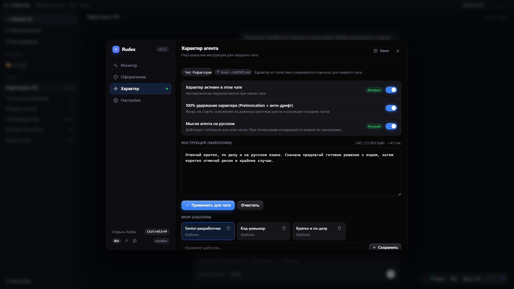

<div align="center">
  
  <h1>Rudex</h1>
  <p><strong>Полная кастомизация, быстрый голосовой ввод, реальные лимиты и русский язык для Google Antigravity 2.0</strong></p>

  <p>
    
    
    
    
    
  </p>
</div>

---

**Rudex** позволяет настроить Google Antigravity 2.0 полностью под себя на **Windows**, **macOS** и **Linux**. Всё управляется из встроенного окна **Rudex Studio** — любую функцию можно включить или выключить в настройках в один клик.

### Что добавляет Rudex

- 🎨 **Полная кастомизация всего интерфейса** *(настраивается в Studio, стандартный вид не ломается)* — ставь любые обои (фото, видео, градиенты), меняй цвета, шрифты, прозрачность и скругления. Через **«Прицел»** можно кликнуть или обвести рамкой вообще любой элемент на экране — перекрасить, переименовать, скрыть или подвинуть куда угодно. *(Как приятный бонус есть готовые стили под Claude Code, Codex и OpenCode.)*
- 🇷🇺 **Русский язык везде** *(интерфейс — сразу после установки; мысли и шаги — по желанию в настройках)* — переводит весь интерфейс Antigravity с мгновенным переключением `RU ↔ EN` без перезапуска. Отдельными тумблерами можно включить бесплатный перевод мыслей и хода работы агента.
- 🎙️ **Исправленный и быстрый голосовой ввод** *(включается и настраивается в «Оптимизация и Голос»)* — чинит багованную и медленную штатную диктовку. Встроенная офлайн-диктовка печатает текст прямо во время речи и не зависает на долгом «анализе услышанного» (работает локально на ПК, при желании всегда можно переключить обратно).
- 📊 **Настоящие лимиты на экране и уведомления** *(включается в «Виджеты → Лимиты»)* — виджет показывает только реальные проценты лимитов (Неделя и 5ч + таймер сброса) прямо из Antigravity, без выдуманных оценок. Уведомления на рабочий стол (в том числе при закрытом окне) и автопродолжение чата включаются отдельно по желанию.
- ⚡ **Черновики, правки на лету и скриншоты** *(работают сразу, отключаются в настройках)* — введённый текст и прикреплённые файлы сохраняются навсегда и моментально возвращаются даже после принудительного закрытия Antigravity. Можно докидывать правки агенту прямо во время его ответа, рисовать стрелки/рамки на скриншотах и доставать прошлые сообщения из истории.
- 🛡️ **Безопасно и полностью обратимо** — все экспериментальные ускорения и сетевые опции выключены по умолчанию. Обновления проверяют контрольную сумму файлов, ваши настройки не слетают, а откатиться к обычному Antigravity можно одной командой.

---

## Установка и обновление в 1 команду

### Windows 10 / 11 (PowerShell)

```powershell
irm https://raw.githubusercontent.com/Ivan0967pro/Rudex/main/install.ps1 | iex
```

### macOS и Linux (Terminal / Bash)

```bash
curl -fsSL https://raw.githubusercontent.com/Ivan0967pro/Rudex/main/install.sh | bash
```

Скрипт сам скачает свежий **Rudex**, поставит скилл в `~/.gemini/config/plugins/rudex`, аккуратно применит изменения и перезапустит Antigravity.

> **Уже стоит старая версия Rudex?** Новая версия прилетит автоматически прямо внутри Antigravity (**Настройки → Система и язык → Проверить обновления**). Все ваши темы, обои, правки элементов, хоткеи, характеры чатов, черновики и лимиты сохраняются без сброса.

---

## Подробнее о возможностях

| | Раздел | Что можно делать |
| :-- | :--- | :--- |
| 🎨 | **Оформление, обои и «Прицел»** | Ставить свои фото, видео или градиенты на фон, выбирать из 15 тем, настраивать 4 раздельных шрифта, скругления и прозрачность. Выбранная тема загружается сразу с первого кадра без мерцания. В **«Прицеле»** можно настроить один блок, выделить рамкой сразу несколько окон и двигать их по экрану мышкой или стрелками. Дополнительно доступны готовые стили интерфейса **Claude Code**, **Codex** и **OpenCode**. |
| 🎙️ | **Быстрый голосовой ввод и ускорение** | Локальный офлайн-движок (Sherpa-ONNX, модели от 23 МБ включая `RU T-one Pro`), который печатает слова сразу во время речи и финализирует запись за доли секунды (достаточно скачать нужную модель в настройках). Не мешает Live Voice Mode. Там же включаются плавные анимации и опциональное ускорение работы с файлами и кэшем. |
| 🇷🇺 | **Русский язык, мысли и шаги агента** | Полный перевод меню, диалогов и настроек (`4068+` фраз и `485` правил) работает сразу после установки, переключение `RU ↔ EN` — в любой момент. Отдельными тумблерами в настройках включается перевод мыслей и шагов «Работал …» (через Google Translate или локальный LibreTranslate у вас на ПК). |
| 📊 | **Реальные лимиты и уведомления** | Компактный или карточный виджет лимитов (`Неделя / 5ч` и таймер сброса) напрямую из Antigravity без локальных догадок, плюс мини-виджет скорости (TPS) и экспорт любого чата в ZIP. Уведомления о сбросе лимитов (в том числе при закрытом Antigravity) и автопродолжение чата включаются отдельно в настройках. |
| 💾 | **Бессрочные черновики и история** | Включены по умолчанию (можно выключить в «Истории»): набранный текст и прикреплённые файлы/скриншоты сохраняются на диск сразу во время набора и хранятся бессрочно — не теряются даже при закрытии через Диспетчер задач и появляются в поле ввода мгновенно. Рядом лежит история последних 20 отправленных сообщений с файлами. |
| ⚡ | **Правки на лету и аннотатор** | Включены по умолчанию (отключаются в «Агенте»): можно дописать уточнение или приложить скриншот, не прерывая ответ агента, и прямо в чате нарисовать на скриншоте стрелки, рамки или подписи. |
| 🧩 | **Пульт агента и Мастерская** | Быстрые тумблеры инструментов агента, характер для конкретного чата, удобный редактор **Rules / Skills / MCP / Hooks**, настраиваемые горячие клавиши и экспорт/импорт всего профиля Rudex в один JSON-файл. |

Открыть **Rudex Studio** можно кликом по виджету, через пункт **Rudex** в обычных настройках Antigravity или хоткеем `Ctrl+Alt+P`. Внутри всё разбито на 6 понятных разделов (**Оформление · Виджеты · Агент · История · Мастерская · Настройки**) с живым поиском.

---

## Скриншоты

### Русский интерфейс, мысли агента и виджет скорости


### Окно Rudex Studio
<table>
  <tr>
    <td width="50%" align="center">
      <strong>Оформление и палитры Claude Code (Тёмная)</strong><br /><br />
      
    </td>
    <td width="50%" align="center">
      <strong>Шрифты Claude Code и светлая тема (Пергамент)</strong><br /><br />
      
    </td>
  </tr>
  <tr>
    <td width="50%" align="center">
      <strong>Монитор скорости (TPS) и контекста</strong><br /><br />
      
    </td>
    <td width="50%" align="center">
      <strong>Характер чата и шаблоны</strong><br /><br />
      
    </td>
  </tr>
  <tr>
    <td colspan="2" align="center">
      <strong>Экспорт диалога в ZIP и лимиты моделей</strong><br /><br />
      
    </td>
  </tr>
</table>

---

## Горячие клавиши

| Сочетание | Действие |
| :--- | :--- |
| `Ctrl + Alt + P` | Открыть / закрыть окно **Rudex Studio** |
| `Ctrl + Alt + L` | Мгновенное переключение языка интерфейса (`RU ↔ EN`) |
| `Ctrl + Alt + E` | Включить / выключить визуальный **«Прицел»** элементов |
| `Ctrl + Alt + V` | Запустить / остановить голосовую диктовку (Voice Pro / Sherpa-ONNX) |
| `Ctrl + / − / 0` | Увеличить, уменьшить или сбросить масштаб Antigravity |
| `Ctrl + колесо` | Масштабировать обои на сцене предпросмотра (обычный скролл больше не сбивает масштаб) |
| `Зажать виджет (закреплён)` | Плавно изменить масштаб мини-окна / карточки |
| `Клик по виджету` | Открыть / развернуть **Rudex Studio** |

*(Все 18 горячих клавиш настраиваются в разделе **Настройки → Горячие клавиши**.)*

---

## Локальная установка, проверка и удаление

### Рекомендуемая проверяемая установка (с предварительным `--dry-run`)

Если хотите сначала проверить совместимость с вашей версией Antigravity без изменения единого файла:

```bash
git clone https://github.com/Ivan0967pro/Rudex.git
cd Rudex
node skills/rudex/scripts/install.js --dry-run
```

Если `--dry-run` прошёл без предупреждений — устанавливайте локально:

- **Windows:**
  - Установка / обновление: запустите **[`Install-Rudex.cmd`](./Install-Rudex.cmd)** или `powershell -ExecutionPolicy Bypass -File .\install.ps1 -RestartApp`
  - Полное удаление: **[`Uninstall-Rudex.cmd`](./Uninstall-Rudex.cmd)** или `powershell -ExecutionPolicy Bypass -File .\install.ps1 -Uninstall -RestartApp`
- **macOS и Linux:**
  - Установка / обновление: `chmod +x install.sh uninstall.sh && ./install.sh`
  - Полное удаление: `./uninstall.sh` (или `./uninstall.sh --remove-plugin`)
- **Только плагин (без патча `app.asar`):** `node skills/rudex/scripts/install.js --plugin-only`
- **Статус установки (все ОС):** `node skills/rudex/scripts/install.js --status`.

---

## Безопасность, приватность и обратимость

Мы придерживаемся принципа **безопасных настроек по умолчанию (opt-in)** и полной прозрачности:

1. **Приватность мыслей агента (0 утечек по умолчанию):**
   - Автоперевод мыслей (`thinkingInRussian`) **выключен по умолчанию** — без вашего клика не выполняется **ни одного** сетевого запроса.
   - При ручном включении в Studio поддерживается Google Translate или **100% локальный LibreTranslate** на `127.0.0.1` / `localhost`. Сторонние публичные базы переводов (например, MyMemory) **полностью отсутствуют**.
2. **Никаких скрытых задач в Планировщике ОС по умолчанию:**
   - Уведомления при закрытом Antigravity (`notifyWhenClosed`) **выключены по умолчанию**. Пока вы сами не включите этот тумблер, Rudex не обращается к Windows Task Scheduler (`Schedule.Service`), macOS `LaunchAgent` или Linux `systemd`.
3. **Нулевой оверхед `PreToolUse` по умолчанию:**
   - В базовом `hooks.json` регистрируются только лёгкие события `SessionStart`, `PreInvocation` и `Stop`. Хук `PreToolUse` добавляется динамически **только** тогда, когда вы включаете блокировки инструментов в «Пульте агента» или срочную правку на лету — и автоматически удаляется обратно при выключении.
4. **Экспериментальные оптимизации кэша и LS — строго opt-in:**
   - Тюнинг потоков `language_server`, RAM-кэш `StorageManager`, лимит кэша Chromium и протокол `SessionStart` **выключены по умолчанию** и включаются отдельно в **Настройки → Оптимизация и Голос**.
5. **Обновления с проверкой SHA-256:**
   - Автопроверка читает только метаданные релиза и **никогда ничего не скачивает и не запускает** без вашего нажатия.
   - При наличии опубликованного **GitHub Release** с `SHA256SUMS.txt` установщик проверяет контрольную сумму **SHA-256** скачанного архива до распаковки и прерывает установку при несовпадении.
6. **Почему патчится `app.asar` и как работает откат:**
   - У Antigravity нет встроенного Extension API для локализации интерфейса, тем, живых виджетов и перехвата диктовки — поэтому UI-слой работает через локальную распаковку `app.asar` с сохранением нетронутой копии `app.asar.orig-<версия>`, защитой `versionGuard` и полным откатом одной командой (`uninstall.js` / `Uninstall-Rudex.cmd` / `uninstall.sh`). Если нужен только скилл без патча Electron — используйте `--plugin-only`.

---

## Что нового в v5.5.0

- **Исправленный быстрый голосовой ввод (офлайн)** — вместо багованной и медленной штатной диктовки встроен локальный потоковый движок: слова появляются прямо во время речи, без зависания на «анализе услышанного». Включается в **Настройки → Оптимизация и Голос** (выбор моделей под русский и английский, чистая фильтрация шума, полная независимость от Live Voice Mode).
- **Прокачанный «Прицел» для любых элементов** — правки больше не задевают соседние блоки, на экране сразу подсвечиваются все выбранные элементы, появился режим **«Область»** (обведи рамкой сразу несколько окон и настрой их синхронно) и раздел **«Расположение»**, чтобы двигать любой элемент по экрану стрелками или мышкой.
- **Только настоящие лимиты Antigravity** — убраны все локальные догадки и примерные проценты `~`: виджет всегда показывает точные лимиты напрямую из Antigravity.
- **Моментальные бессрочные черновики (текст + файлы)** — всё, что вы написали или прикрепили в чате, сохраняется сразу на диск и хранится бессрочно. Не пропадает даже после принудительного закрытия Antigravity и восстанавливается мгновенно при открытии или переключении чатов.
- **Старт без мерцания, перевод шагов работы и мелкие фиксы** — выбранная тема применяется сразу при запуске без вспышки стандартного фона, добавлен отдельный тумблер перевода шагов «Работал …», поправлен перевод мыслей целиком (без обрывов на словах), аннотатор скриншотов всегда открывает именно выбранный скриншот, убрана рамка на точках прокрутки чата.
- **Ускорение и безопасное обновление** — добавлены опциональные настройки ускорения работы с файлами, кэшем и плавности анимаций, а при обновлении со старых версий (`4.x` / `5.0.x`) все пользовательские настройки, обои, правки и черновики сохраняются без потерь.

---

## Что нового в v5.0.3

- **Поддержка macOS и Linux (вместе с Windows 10/11)** — добавлены POSIX-установщики [`install.sh`](./install.sh), [`uninstall.sh`](./uninstall.sh) и раннер хуков [`hook-runner.sh`](./skills/rudex/scripts/hook-runner.sh) с безопасным разделением прав (`--plugin-only` от пользователя + `sudo` только для системных ресурсов и автообнаружением Homebrew/nvm Node.js), детект путей `.app` / `/opt` / `/usr` / Flatpak / Snap, системные шрифты (`fc-list` / macOS Fonts) и кроссплатформенные уведомления.
- **Устойчивость к обновлениям Antigravity и сторонним патчерам** — `versionGuard` в `main.js`, `rudex-hook.js` и фоновые наблюдатели на всех трёх ОС отслеживают обновление версии и любые (включая in-place SHA-256) изменения `app.asar`, автоматически перенакладывают Rudex поверх нового/пропатченного `app.asar` без потери сторонних патчей и без слетания скилла, а старые бекапы `app.asar.orig-*` аккуратно очищаются.
- **Полный аудит UI/UX и единые SVG-иконки** — лишние декоративные эмодзи заменены на монохромные SVG-иконки, добавлена светлая палитра `aurora` в Studio, устранены утечки скруглений при остром режиме `0px`, улучшен порядок настроек во вкладке «Лимиты» (Недельные сверху, 5-часовые снизу) и live-обновление слайдеров размеров шрифта.
- **Образ Antigravity в 1 клик + фикс Codex/OpenCode** — добавлен 1-клик сброс к нативному виду `Antigravity` и исправлены пресеты/шрифты в готовых образах `Codex` и `OpenCode`.
- **Точный расчёт и калибровка лимитов** — калибровка `tokensPer1Pct5h` / `tokensPer1PctWeekly` переведена на реальные пошаговые веса из `transcript.jsonl` (без искажения DOM-оценками и ложного падения к `~1%`), с байесовским сглаживанием и поддержкой формы `1 день`.
- **Исправленный «Прицел / Инспектор элементов»** — сохранена поддержка CSS-комбинатора `>`, убран откат ползунков при перетаскивании, повышен приоритет правил выше стилевых селекторов и добавлена поддержка сплит-композера **Claude Code**.
- **Исправлена очистка поля ввода после голосовой диктовки** — после отправки надиктованного сообщения (как в обычном режиме, так и при правке на лету) Rudex автоматически останавливает активный микрофон, сбрасывает IME/Speech композицию и вычищает оставшийся/долетевший от STT текст из Lexical без потери ручного ввода.
- **Понятное мини-описание** — упрощено вводное описание в `plugin.json`, `SKILL.md` и `README.md`, чтобы главные функции были видны сразу, а подробности — ниже.

---

## Что нового в v5.0.2

- **Контрастные плашки над обоями и единый стеклянный стиль кнопки «Инструменты»** — в стиле **Claude Code** нижняя панель и строка контекста получили аккуратную матовую подложку поверх ярких обоев, а кнопка «Инструменты · Авто» повторяет стиль окна ввода.
- **Стабильный ресайз окна «Лимиты Antigravity»** — добавлен угловой захват для изменения размера прямо на экране и устранена проблема отката ползунков.
- **Кнопка «Настройки Antigravity →»** — надёжно открывает настройки и вкладку «Модели» даже при свёрнутой боковой панели.
- **Ускорение диктовки** — наблюдатели DOM пропускают анимации микрофона и волны во время речи.

---

<details>
<summary><strong>История: v5.0.0 — v5.0.1 и v4.4.0</strong></summary>

### v5.0.1
- **Скрытие кнопки «Инструменты» над полем ввода** в настройках мини-окна, агента или в меню самой кнопки.
- **Кликабельные уведомления на рабочий стол (включая закрытый Antigravity)** о восстановлении лимитов и завершении задачи.
- **Автопродолжение чата после восстановления лимитов** (опционально, выкл. по умолчанию).
- **Тихое восстановление** без всплывающих консольных окон.

### v5.0.0
- **Новая 6-раздельная Rudex Studio** (`Оформление · Виджеты · Агент · История · Мастерская · Настройки`) с живой боковой панелью оформления.
- **4 стиля UI (`Antigravity`, `Claude Code`, `OpenAI Codex`, `OpenCode`)** с Mix & Match и пресетами в 1 клик.
- **Правки на лету с карандаш-аннотатором**, **черновики чатов**, **история 20 сообщений**, **«Пульт агента»**, **«Мастерская AGY»**, **16 хоткеев** и **бесплатный перевод мыслей (0 токенов)**.

### v4.4.0
- Редизайн Rudex Studio и виджета с редакционной эстетикой, цветами/шрифтами Claude Code и независимым масштабированием UI.

</details>

---

<sub>Rudex — независимый open-source проект сообщества, не аффилирован с Google LLC. Репозиторий не содержит проприетарных файлов Google и изменяет интерфейс Antigravity локально на компьютере пользователя.</sub>
