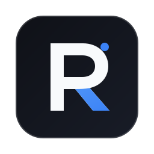

<div align="center">
  
  <h1>Rudex 5.5</h1>
  <p><strong>Студия кастомизации, стили интерфейса, реальные лимиты, офлайн-голос и полная русификация Google Antigravity 2.0</strong></p>

  <p>
    
    
    
    
    
    
  </p>
</div>

---

**Rudex** превращает стандартный Google Antigravity 2.0 в удобную рабочую среду на **Windows 10/11**, **macOS** и **Linux**. Всё настраивается в 1 клик через встроенную панель **Rudex Studio** (`Ctrl + Alt + P`).

### Коротко о главном

- 🇷🇺 **Полная русификация, перевод мыслей и шагов работы** — 4068+ фраз, 485 динамических правил, мгновенное переключение `RU ↔ EN` (`Ctrl + Alt + L`), 0-кадровый старт выбранной темы без мерцания и раздельные опциональные тумблеры перевода мыслей и хода работы агента («Работал …») через Google Translate или локальный LibreTranslate (`127.0.0.1`).
- 🎙️ **Голосовой ввод Pro (офлайн Sherpa-ONNX)** — мгновенная локальная потоковая диктовка (~8 мс финализация, модели `RU T-one Pro` / `RU Быстрая` / `RU Точная` / `RU+EN Мульти` / `EN Быстрая`, чистый DSP-фильтр, хоткей `Ctrl + Alt + V`, 100% изоляция от Live Voice Mode).
- 🎛️ **Стили интерфейса, 15 тем и «Прицел» v5.5** — мгновенное переключение между **Antigravity**, **Claude Code**, **OpenAI Codex** и **OpenCode**, 15 тем, 4 слота шрифтов, живые обои и точечный «Прицел» (`Ctrl + Alt + E`) с выделением области рамкой (синхронная правка 2+ окон), живой подсветкой совпадений и блоком «Расположение» (D-pad, выравнивание и перетаскивание мышью).
- 📊 **Точные лимиты Antigravity и уведомления** — виджет реальных квот напрямую из Antigravity (Неделя / 5ч + таймер сброса, без локальных догадок и `~`), уведомления на рабочий стол о восстановлении лимитов, опциональные уведомления при закрытом окне и автопродолжение.
- ⚡ **Моментальные бессрочные черновики и правки на лету** — 0 мс восстановление введённого текста и прикреплённых файлов/скриншотов после перезапуска или принудительного закрытия (бессрочно, до 500 чатов), история 20 сообщений, правки без остановки генерации и аннотатор скриншотов.
- 🛡️ **Приватность по умолчанию, совместимость и обратимость** — нулевой оверхед `PreToolUse`, opt-in тюнинг кэша и `language_server`, проверка **SHA-256** для GitHub Releases, бесшовное обновление со старых версий `4.x` / `5.0.x` с сохранением всех настроек и чистый откат к `app.asar`.

> Подробное описание всех модулей, горячих клавиш и скриншоты — ниже на странице.

---

## Установка и обновление в 1 команду

### Windows 10 / 11 (PowerShell)

```powershell
irm https://raw.githubusercontent.com/Ivan0967pro/Rudex/main/install.ps1 | iex
```

### macOS и Linux (Terminal / Bash)

```bash
curl -fsSL https://raw.githubusercontent.com/Ivan0967pro/Rudex/main/install.sh | bash
```

Скрипт скачает свежую версию **Rudex 5.5.0**, установит скилл в `~/.gemini/config/plugins/rudex`, аккуратно пропатчит интерфейс и перезапустит Antigravity.

> **Уже стоит Rudex 4.x или 5.0.x?** Обновление до **v5.5.0** прилетит автоматически прямо внутри Antigravity (кнопка **«Обновить сейчас»** в уведомлении или **Настройки → Система и язык → Проверить обновления**). Все настройки, темы, обои, правки «Прицела», переименования, хоткеи, характеры чатов, черновики, история и квоты сохраняются локально без сброса.

---

## Подробнее о модулях Rudex 5.5

| | Модуль | Что даёт |
| :-- | :--- | :--- |
| 🎛️ | **4 стиля интерфейса платформ** | Мгновенное переключение между **Antigravity**, **Claude Code** (ровный однострочный и многострочный композер, стабильная диктовка и микрофон, чистая панель под полем ввода), **OpenAI Codex** и **OpenCode** + **Mix & Match** по зонам и полные комплекты платформы в 1 клик. |
| 🎨 | **15 тем, шрифты, обои и «Прицел» v5.5** | 15 тем (включая **Claude Code · Тёмная / Светлая / Терминал**, **Светлая бумага**, **Скандинавский лёд**, **Жидкое стекло**), 0-кадровый старт без мерцания, 4 раздельных слота шрифтов, студия обоев (фото, видео, градиенты, зум `Ctrl + колесо`), конструктор скруглений и «Прицел» (`Ctrl+Alt+E`) с изоляцией от соседей, выделением области рамкой (2+ окна синхронно) и точным сдвигом/перетаскиванием элементов. |
| 📊 | **Реальные лимиты, уведомления и контекст модели** | Встроенные или плавающие виджеты (`Неделя / 5ч` напрямую из RPC и Настроек Antigravity — только настоящие проценты без локальных догадок), **кликабельные уведомления на рабочий стол** о завершении задачи и восстановлении лимитов (опционально и при закрытом Antigravity), индикатор контекстного окна и опциональное автопродолжение. |
| 🧭 | **Rudex Studio (6 разделов + живой поиск)** | Понятная навигация по 3 группам: **Оформление · Виджеты · Агент · История · Мастерская · Настройки**. Липкие подвкладки, неблокирующая боковая панель оформления с живым предпросмотром и историей `Назад / Вперёд`, мгновенный поиск по настройкам и вход в **Rudex** прямо из родных `⚙ Настройки` Antigravity. |
| 🎙️ | **Голосовой ввод Pro и оптимизация ПК** | Офлайн-движок **Sherpa-ONNX** (~8 мс финализация, модели от 23 МБ включая `RU T-one Pro` 80Кч), кэшированный DSP AudioWorklet, фикс Windows WASAPI, опциональное ускорение `language_server`, RAM-кэш, безопасная очистка кэшей и плавные GPU-анимации 60–144 FPS. |
| ⚡ | **Правки на лету и аннотатор скриншотов** | Отправка дополнений, скриншотов и файлов агенту без остановки текущего ответа + встроенный аннотатор (карандаш, стрелки, рамки, текст) с точным визуальным подбором оригинала по отпечатку и настраиваемой меткой «Учтено агентом». |
| 💾 | **Моментальные бессрочные черновики и история 20 сообщений** | Бессрочное автосохранение текста и прикреплённых файлов/скриншотов отдельно для каждого чата (до 500 чатов), устойчивое к принудительному закрытию (`taskkill /F`) и с мгновенным (0 мс) восстановлением при старте и переключении чатов + история последних 20 отправок. |
| 🧩 | **Пульт агента и Мастерская AGY** | Скрываемая кнопка «Инструменты» над полем ввода (`Авто / Вкл / Выкл`), пресеты возможностей, характер чата, визуальное управление **Rules / Skills / MCP / Hooks**, 18 настраиваемых горячих клавиш, экспорт диалогов в ZIP и JSON-бекап профиля. |
| 🇷🇺 | **Полная русификация, мысли и ход работы** | `4068+` записей словаря и `485` динамических правил, мгновенное переключение `RU ↔ EN` (`Ctrl+Alt+L`) без перезапуска + раздельные опциональные тумблеры перевода мыслей агента и хода работы («Работал …») без расхода токенов. |

Открыть **Rudex Studio** можно через `Ctrl+Alt+P`, клик по виджету или пункт **Rudex** в основных настройках Antigravity.

---

## Скриншоты

### Русский интерфейс, мысли агента и виджет скорости


### Окно Rudex Studio
<table>
  <tr>
    <td width="50%" align="center">
      <strong>Оформление и палитры Claude Code (Тёмная)</strong><br /><br />
      
    </td>
    <td width="50%" align="center">
      <strong>Шрифты Claude Code и светлая тема (Пергамент)</strong><br /><br />
      
    </td>
  </tr>
  <tr>
    <td width="50%" align="center">
      <strong>Монитор скорости (TPS) и контекста</strong><br /><br />
      
    </td>
    <td width="50%" align="center">
      <strong>Характер чата и шаблоны</strong><br /><br />
      
    </td>
  </tr>
  <tr>
    <td colspan="2" align="center">
      <strong>Экспорт диалога в ZIP и лимиты моделей</strong><br /><br />
      
    </td>
  </tr>
</table>

---

## Горячие клавиши

| Сочетание | Действие |
| :--- | :--- |
| `Ctrl + Alt + P` | Открыть / закрыть окно **Rudex Studio** |
| `Ctrl + Alt + L` | Мгновенное переключение языка интерфейса (`RU ↔ EN`) |
| `Ctrl + Alt + E` | Включить / выключить визуальный **«Прицел»** элементов |
| `Ctrl + Alt + V` | Запустить / остановить голосовую диктовку (Voice Pro / Sherpa-ONNX) |
| `Ctrl + / − / 0` | Увеличить, уменьшить или сбросить масштаб Antigravity |
| `Ctrl + колесо` | Масштабировать обои на сцене предпросмотра (обычный скролл больше не сбивает масштаб) |
| `Зажать виджет (закреплён)` | Плавно изменить масштаб мини-окна / карточки |
| `Клик по виджету` | Открыть / развернуть **Rudex Studio** |

*(Все 18 горячих клавиш настраиваются в разделе **Настройки → Горячие клавиши**.)*

---

## Локальная установка, проверка и удаление

### Рекомендуемая проверяемая установка (с предварительным `--dry-run`)

Если хотите сначала проверить совместимость с вашей версией Antigravity без изменения единого файла:

```bash
git clone https://github.com/Ivan0967pro/Rudex.git
cd Rudex
node skills/rudex/scripts/install.js --dry-run
```

Если `--dry-run` прошёл без предупреждений — устанавливайте локально:

- **Windows:**
  - Установка / обновление: запустите **[`Install-Rudex.cmd`](./Install-Rudex.cmd)** или `powershell -ExecutionPolicy Bypass -File .\install.ps1 -RestartApp`
  - Полное удаление: **[`Uninstall-Rudex.cmd`](./Uninstall-Rudex.cmd)** или `powershell -ExecutionPolicy Bypass -File .\install.ps1 -Uninstall -RestartApp`
- **macOS и Linux:**
  - Установка / обновление: `chmod +x install.sh uninstall.sh && ./install.sh`
  - Полное удаление: `./uninstall.sh` (или `./uninstall.sh --remove-plugin`)
- **Только плагин (без патча `app.asar`):** `node skills/rudex/scripts/install.js --plugin-only`
- **Статус установки (все ОС):** `node skills/rudex/scripts/install.js --status`.

---

## Безопасность, приватность и обратимость

Мы придерживаемся принципа **безопасных настроек по умолчанию (opt-in)** и полной прозрачности:

1. **Приватность мыслей агента (0 утечек по умолчанию):**
   - Автоперевод мыслей (`thinkingInRussian`) **выключен по умолчанию** — без вашего клика не выполняется **ни одного** сетевого запроса.
   - При ручном включении в Studio поддерживается Google Translate или **100% локальный LibreTranslate** на `127.0.0.1` / `localhost`. Сторонние публичные базы переводов (например, MyMemory) **полностью отсутствуют**.
2. **Никаких скрытых задач в Планировщике ОС по умолчанию:**
   - Уведомления при закрытом Antigravity (`notifyWhenClosed`) **выключены по умолчанию**. Пока вы сами не включите этот тумблер, Rudex не обращается к Windows Task Scheduler (`Schedule.Service`), macOS `LaunchAgent` или Linux `systemd`.
3. **Нулевой оверхед `PreToolUse` по умолчанию:**
   - В базовом `hooks.json` регистрируются только лёгкие события `SessionStart`, `PreInvocation` и `Stop`. Хук `PreToolUse` добавляется динамически **только** тогда, когда вы включаете блокировки инструментов в «Пульте агента» или срочную правку на лету — и автоматически удаляется обратно при выключении.
4. **Экспериментальные оптимизации кэша и LS — строго opt-in:**
   - Тюнинг потоков `language_server`, RAM-кэш `StorageManager`, лимит кэша Chromium и протокол `SessionStart` **выключены по умолчанию** и включаются отдельно в **Настройки → Оптимизация и Голос**.
5. **Обновления с проверкой SHA-256:**
   - Автопроверка читает только метаданные релиза и **никогда ничего не скачивает и не запускает** без вашего нажатия.
   - При наличии опубликованного **GitHub Release** с `SHA256SUMS.txt` установщик проверяет контрольную сумму **SHA-256** скачанного архива до распаковки и прерывает установку при несовпадении.
6. **Почему патчится `app.asar` и как работает откат:**
   - У Antigravity нет встроенного Extension API для локализации интерфейса, тем, живых виджетов и перехвата диктовки — поэтому UI-слой работает через локальную распаковку `app.asar` с сохранением нетронутой копии `app.asar.orig-<версия>`, защитой `versionGuard` и полным откатом одной командой (`uninstall.js` / `Uninstall-Rudex.cmd` / `uninstall.sh`). Если нужен только скилл без патча Electron — используйте `--plugin-only`.

---

## Что нового в v5.5.0

- **Голосовой ввод Pro (офлайн Sherpa-ONNX) + оптимизация и плавные анимации** — встроенный локальный потоковый движок **Sherpa-ONNX** (финализация за ~8 мс, модели `RU T-one Pro` 80Кч / `RU Быстрая` / `RU Точная` / `RU+EN Мульти` / `EN Быстрая`, чистый DSP-фильтр, хоткей `Ctrl+Alt+V`, 100% изоляция от Live Voice Mode), opt-in ускорение `language_server` / кэша и плавные GPU-анимации 60–144 FPS.
- **«Прицел» v5.5: нулевая утечка стилей, выделение области и «Расположение»** — полностью переработанный селектор (лимит длины `1600`, глубина `40`, бейдж числа совпадений и подсветка всех затронутых блоков на экране), режим **«Область»** (протяжка рамкой для синхронной настройки 2+ окон со съёмными чипами) и отдельный блок **«Расположение»** (D-pad с шагом `1/4/16/40px`, пресеты выравнивания и живое перетаскивание мышью).
- **Только реальные лимиты Antigravity (без `~` и догадок)** — полностью убрано локальное автосписание процентов: виджет и карточки лимитов показывают только официальные значения напрямую из пассивного RPC-наблюдателя и страницы Настройки → Модели Antigravity.
- **Моментальные бессрочные черновики (текст + файлы, устойчивые к `taskkill /F`)** — запись на диск идёт непрерывно при наборе и прикреплении файлов (включая отсоединённый `<input type="file">`, `paste`, `drop` и буфер обмена), черновики хранятся **бессрочно** (до 500 чатов), а восстановление при открытии и переключении чатов происходит за **0 мс** через синхронную предзагрузку `boot-state-sync`, раннее определение чата из сайдбара и Main-World инъекцию Lexical/File.
- **0-кадровый старт темы и перевод хода работы агента** — убрано мерцание стандартной темы при запуске Antigravity; добавлен отдельный тумблер перевода шагов работы (`workLogInRussian` — «Работал …»), обновлён словарь (4068+ фраз, 485 правил), исправлено пословное дробление перевода мыслей, аннотатор скриншотов переведён на визуальное сопоставление по RGB-отпечатку, убрана рамка на точках таймлайна и исправлен ховер на «+ Новый чат».
- **Безопасность, приватность и кросс-ОС обновления** — безопасные opt-in значения по умолчанию, динамический `PreToolUse` хук с нулевым оверхедом, чистая Node-распаковка ZIP без PowerShell с защитой от Zip-Slip и проверкой SHA-256 релизов, бесшовное обновление со старых версий `4.x` / `5.0.x` без потери пользовательских настроек.

---

## Что нового в v5.0.3

- **Поддержка macOS и Linux (вместе с Windows 10/11)** — добавлены POSIX-установщики [`install.sh`](./install.sh), [`uninstall.sh`](./uninstall.sh) и раннер хуков [`hook-runner.sh`](./skills/rudex/scripts/hook-runner.sh) с безопасным разделением прав (`--plugin-only` от пользователя + `sudo` только для системных ресурсов и автообнаружением Homebrew/nvm Node.js), детект путей `.app` / `/opt` / `/usr` / Flatpak / Snap, системные шрифты (`fc-list` / macOS Fonts) и кроссплатформенные уведомления.
- **Устойчивость к обновлениям Antigravity и сторонним патчерам** — `versionGuard` в `main.js`, `rudex-hook.js` и фоновые наблюдатели на всех трёх ОС отслеживают обновление версии и любые (включая in-place SHA-256) изменения `app.asar`, автоматически перенакладывают Rudex поверх нового/пропатченного `app.asar` без потери сторонних патчей и без слетания скилла, а старые бекапы `app.asar.orig-*` аккуратно очищаются.
- **Полный аудит UI/UX и единые SVG-иконки** — лишние декоративные эмодзи заменены на монохромные SVG-иконки, добавлена светлая палитра `aurora` в Studio, устранены утечки скруглений при остром режиме `0px`, улучшен порядок настроек во вкладке «Лимиты» (Недельные сверху, 5-часовые снизу) и live-обновление слайдеров размеров шрифта.
- **Образ Antigravity в 1 клик + фикс Codex/OpenCode** — добавлен 1-клик сброс к нативному виду `Antigravity` и исправлены пресеты/шрифты в готовых образах `Codex` и `OpenCode`.
- **Точный расчёт и калибровка лимитов** — калибровка `tokensPer1Pct5h` / `tokensPer1PctWeekly` переведена на реальные пошаговые веса из `transcript.jsonl` (без искажения DOM-оценками и ложного падения к `~1%`), с байесовским сглаживанием и поддержкой формы `1 день`.
- **Исправленный «Прицел / Инспектор элементов»** — сохранена поддержка CSS-комбинатора `>`, убран откат ползунков при перетаскивании, повышен приоритет правил выше стилевых селекторов и добавлена поддержка сплит-композера **Claude Code**.
- **Исправлена очистка поля ввода после голосовой диктовки** — после отправки надиктованного сообщения (как в обычном режиме, так и при правке на лету) Rudex автоматически останавливает активный микрофон, сбрасывает IME/Speech композицию и вычищает оставшийся/долетевший от STT текст из Lexical без потери ручного ввода.
- **Понятное мини-описание** — упрощено вводное описание в `plugin.json`, `SKILL.md` и `README.md`, чтобы главные функции были видны сразу, а подробности — ниже.

---

## Что нового в v5.0.2

- **Контрастные плашки над обоями и единый стеклянный стиль кнопки «Инструменты»** — в стиле **Claude Code** нижняя панель и строка контекста получили аккуратную матовую подложку поверх ярких обоев, а кнопка «Инструменты · Авто» повторяет стиль окна ввода.
- **Стабильный ресайз окна «Лимиты Antigravity»** — добавлен угловой захват для изменения размера прямо на экране и устранена проблема отката ползунков.
- **Кнопка «Настройки Antigravity →»** — надёжно открывает настройки и вкладку «Модели» даже при свёрнутой боковой панели.
- **Ускорение диктовки** — наблюдатели DOM пропускают анимации микрофона и волны во время речи.

---

<details>
<summary><strong>История: v5.0.0 — v5.0.1 и v4.4.0</strong></summary>

### v5.0.1
- **Скрытие кнопки «Инструменты» над полем ввода** в настройках мини-окна, агента или в меню самой кнопки.
- **Кликабельные уведомления на рабочий стол (включая закрытый Antigravity)** о восстановлении лимитов и завершении задачи.
- **Автопродолжение чата после восстановления лимитов** (опционально, выкл. по умолчанию).
- **Тихое восстановление** без всплывающих консольных окон.

### v5.0.0
- **Новая 6-раздельная Rudex Studio** (`Оформление · Виджеты · Агент · История · Мастерская · Настройки`) с живой боковой панелью оформления.
- **4 стиля UI (`Antigravity`, `Claude Code`, `OpenAI Codex`, `OpenCode`)** с Mix & Match и пресетами в 1 клик.
- **Правки на лету с карандаш-аннотатором**, **черновики чатов**, **история 20 сообщений**, **«Пульт агента»**, **«Мастерская AGY»**, **16 хоткеев** и **бесплатный перевод мыслей (0 токенов)**.

### v4.4.0
- Редизайн Rudex Studio и виджета с редакционной эстетикой, цветами/шрифтами Claude Code и независимым масштабированием UI.

</details>

---

<sub>Rudex — независимый open-source проект сообщества, не аффилирован с Google LLC. Репозиторий не содержит проприетарных файлов Google и изменяет интерфейс Antigravity локально на компьютере пользователя.</sub>
